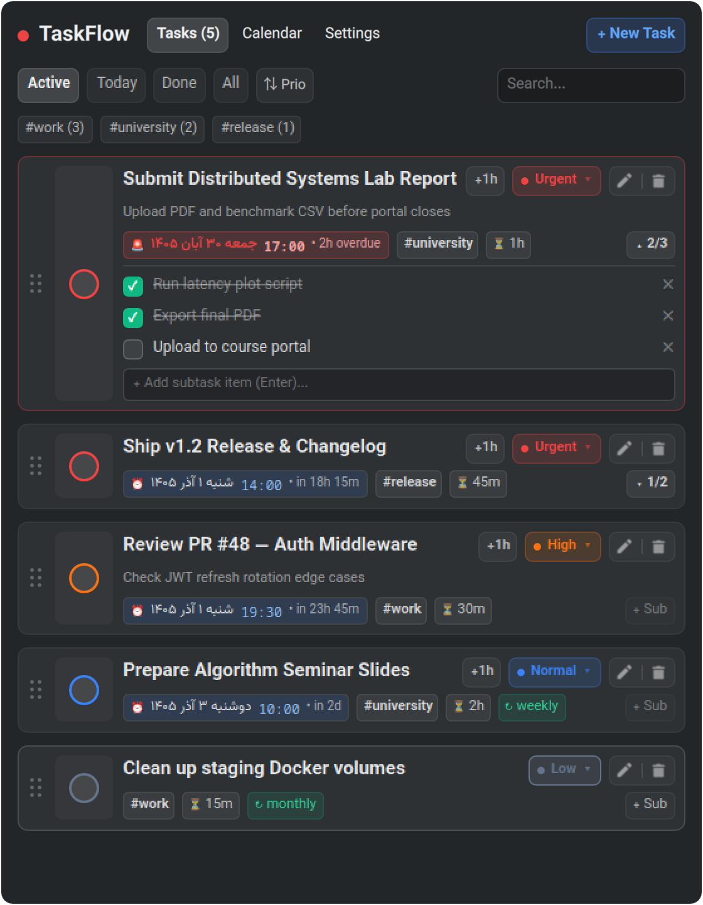
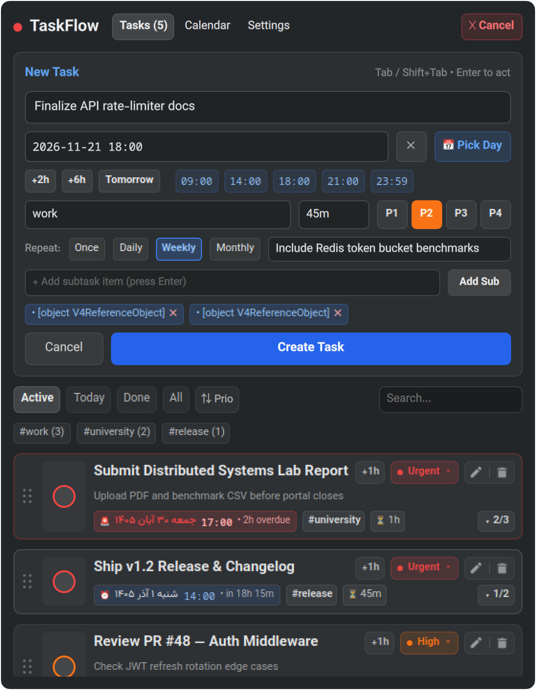
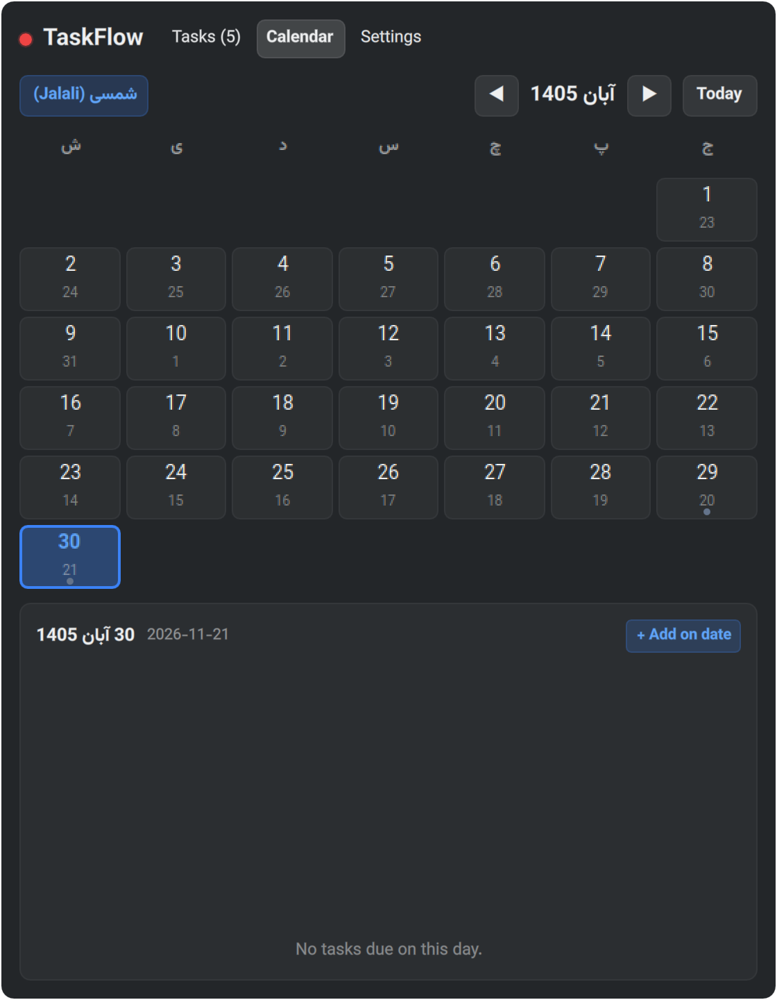

# TaskFlow

A Raycast/Linear-inspired task, deadline, and reminder manager for **KDE Plasma 6**, backed by a lightweight SQLite WAL daemon and a terminal CLI.

## Screenshots

### Panel Pill


### Popout Views

| Dashboard & Subtasks | Smart Task Form | Dual Jalali & Gregorian Calendar |
| :---: | :---: | :---: |
|  |  |  |

## Features

- **Smart Panel Pill**: 3-part compact panel widget showing the top priority/focus task, live urgency/deadline context badge, active counter, and mouse-wheel task cycling.
- **Bento Popout Dashboard**: Filterable task list (`Active`, `Today`, `Done`, `All`), tag filtering, instant search, drag-and-drop manual reordering with wheel-scroll support (preserving task priority), double-click editing, and inline priority picker.
- **Smart Form & Keyboard Navigation**: Full `Tab` / `Shift+Tab` / `Enter` workflow with `#tag` autocomplete, quick deadline presets, recurring schedules, time estimates, and subtasks.
- **Dual Jalali & Gregorian Calendar**: Interactive month grid with per-day task indicators and Jalali/Gregorian toggle.
- **Desktop Notifications**: Background reminder daemon using `notify-send` with snooze/complete actions.
- **Terminal CLI (`taskflow`)**: Manage tasks, subtasks, snooze, and stats directly from your terminal.

## Project Structure

- `bin/plasma_taskflow_daemon.py` — Background Python daemon (SQLite WAL storage, threaded HTTP API on `127.0.0.1:28490`, reminder loop, recurring task generator).
- `bin/taskflow` — Terminal CLI client (`list`, `add`, `edit`, `snooze`, `done`, `del`, `sub`, `stats`, `clear`).
- `plasmoid/` — KDE Plasma 6 QML widget (`org.kde.plasma.taskflow`).
- `systemd/plasma-taskflow.service` — User systemd service unit template.
- `install.sh` — Symlinks CLI, daemon, and plasmoid into `~/.local/`, updates cached Plasma popup geometry, and restarts `plasma-taskflow.service`.

## Installation

1. Install the systemd user service:

```bash
mkdir -p ~/.config/systemd/user
cp systemd/plasma-taskflow.service ~/.config/systemd/user/
systemctl --user daemon-reload
systemctl --user enable --now plasma-taskflow.service
```

2. Symlink the CLI, daemon, and Plasma 6 widget:

```bash
./install.sh
systemctl --user restart plasma-plasmashell.service
```

3. Add **TaskFlow** (`org.kde.plasma.taskflow`) to your KDE Plasma panel.

## CLI Usage

```bash
taskflow list
taskflow add "Finish report" --prio 1 --tag work --due "tomorrow 18:00"
taskflow done <id>
taskflow snooze <id> 1h
taskflow stats
```
